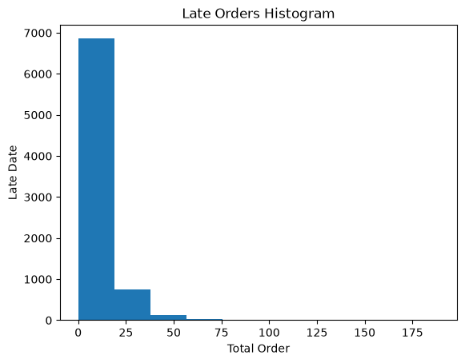
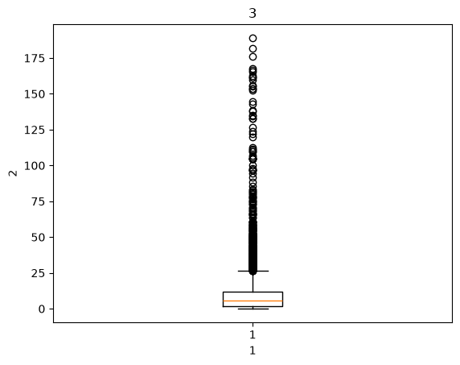
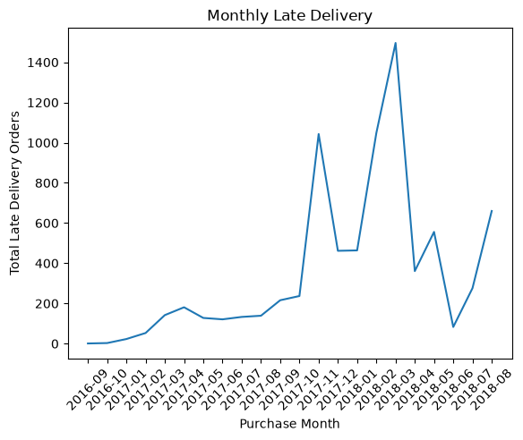
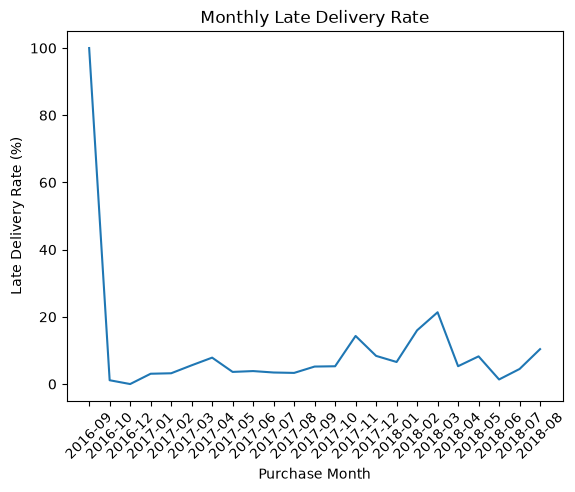

# **RQ1 - Delivery Performance Analysis**
## **1. Business Context**
Delivery is one the most important process of e-commerce transactions because the customer experience does not end when a purchase is made, it continues untill the order reaches the customer's hands. 

After placing an order, customers rely on the estimated delivery date provided by the marketplace to anticipate when their purchases will arrive. Deliveries that arrive later than the promised date may lead to customers complaints, negative reviews, and potentially reduced customer loyalty. 

For this reason, evaluating delivery performance is essential to understanding how effectively a marketplace meets its delivery commitments. This evaluation focuses on the frequency of late deliveries, the duration of delivery delays, and changes in delivery performance over time.

Using the Olist Brazilian E-Commerce Public Dataset, this analysis aims to evaluate Olist's overall delivery performance.

## **2. Business Question & Objective**
### **2.1. Business Question**
How well is Olist Marketplace performing in terms of delivery?

To address this question, the analysis examines three aspects of delivery performance:
1. The proportion of orders delivered on time versus late.
2. The distribution and duration of late deliveries.
3. Changes in delivery performance over time.

### **2.2. Objectives**
The objectives of this analysis are to:
1. Evaluate delivery reliability by measuring the proportion of on-time and late deliveries.
2. Examine the distribution of delivery delays to understand how severe late deliveries are.
3. Examine monthly delivery performance by tracking changes in both the number and proportion of late deliveries over time.

## **3. Dataset & Scope**
### **3.1. Dataset**
This analysis uses the Olist Brazilian E-Commerce Public Dataset, obtained from Kaggle. The dataset contains information about e-commerce transactions, including order details, customer information, seller information, delivery timestamps, and other aspects of marketplace operations.

For this research question, the analysis primarily uses the `olist_orders_dataset` table, which contains order-level information such as purchase timestamp, estimated delivery dates, and actual delivery dates.

The original dataset consists of **99,441 orders**, with each observation representasing an individual order.

### **3.2. Scope of Analysis**
The analysis focuses exclusively on orders with a `delivered` status and non-null actual delivery dates. Orders with other statuses or missing actual delivery dates are excluded because their delivery performance cannot be reliably evaluated by comparing actual and estimated delivery dates.

After applying these criteria, **96,470 orders** are included in the analisis.

The analysis examines overal delivery performance, the distribution of late delivery durations, and monthly changes in late delivery performance.

### **3.3. Analysis Period**
The observation period is based on the order purchase timestamps of the eligible orders, covering September 2016 to August 2018.

## **4. Metrics & Definitions**
This analysis uses several metrics to evaluate delivery performance and examine delivery delays.
### **4.1. Delivery Status**
Orders are classified into two categories based on the comparison between the actual delivery date and the estimated delivery date:

**- On Time:** Orders delivered on or before the estimated delivery date.

**- Late:** Orders delivered after the estimated delivery date.

### **4.2. On-time Delivery Rate**
The proportion of eligible orders delivered on or before the estimated delivery date, calculated as:

On-time Delivery Rate = (On-time Orders/Eligible Orders) x 100%

### **4.3. Late Delivery Rate**
The proportion of eligible orders delivered after the estimated delivery date, calculated as:

Late Delivery Rate = (Late Orders/Eligible Orders) x 100%

### **4.4. Late Delivery Duration**
The number of days an order is delayed beyond its estimated delivery date, calculated as:

Delay Days = Actual Delivery Date - Estimated Delivery Date

Only order with a positive delay duration are included in the late delivery duration analysis.

### **4.5. Monthly Late Delivery Frequency**
The number of late orders grouped by their purchase month, using the order purchase timestamp as the reference.

### **4.6. Monthly Late Delivery Rate**
The proportion of late orders relative to all eligible orders within the same purchase month, calculated as:

Monthly Late Delivery Rate = (Monthly Late Orders/Monthly Eligible Orders) x 100%

## **5. Methodology**
This analysis was conducted using SQL and Python to examine delivery performance from different perpective.

### **5.1. Data Exploration and Quality Assesment**
The dataset was initially examined to undertand its structure, data types, completeness, and consistency. Data quality checks included identifying missing values, duplicate records, and verifying the order-level granularity of the dataset.

### **5.2. Delivery Performance Classification**
SQL was used to classify eligible orders into on-time and deliveries by comparing their estimated delivery dates with their actual delivery dates. The number and proportion of orders in each category were then calculated to evaluate overall delivery performance.

### **5.3. Late Delivery Distribution Anlysis**
Python was used to calculate the delay duration for each late order and examine its distribution. Descriptive statistics, histograms, and boxplots were used to understand the typical delay duration and identify potential outliers using the Interquartile Range (IQR) method.

### **5.4. Monthly Delivery Performance Analysis**
Monthly delivery performance was examined by grouping orders according to their purchase month. The analysis measured both the number and the rate of monthly late deliveriy to observe changes in delivery performance over time.

## **6. Analysis & Findings**
### **6.1. Data Exploration and Quality Assesment**
#### **DUPLICATE CHECK**
Duplication were checked to ensure that each order was appropriately represented at order level, as duplicates could affect the accuracy of delivery performance calculations. The `order_id` column was examined to identify potential duplicate records. The result showed that **no duplicate `order_id` values were found**, indicating that each row represents a unique order.

#### **LOGICAL CONSISTENCY CHECK**
Logical consistency check was performed on `order_purchase_timestamp` column and `order_delivered_cust_date` column. The check verified that the purchase timestamp occured before the time an order arrived at customers. The result showed that all orders with available timestamps followed this expected chronological sequence, indicating **no logical inconsistencies were found** between the two columns.

#### **NULL DATA CHECK AND DATA FILTERING**
NULL data were checked to ensure that all columns that will be used have all the information needed. The columns that were checked consist of `order_id`, `order_purchase_timestamp`, `order_delivered_cust_date`, and `order_estimated_delivery_date`. The result showed in table below:
| Total Order | NULL order_id | NULL purchase | NULL delivered_cust | NULL estimated_delivery |
| :---: | :---: | :---: | :---: | :---: |
| 99441 | 0 | 0 | 2,965 | 0 |

The table above showed that there were 2,965 orders with NULL value in `order_delivered_cust_date`. This result could indicate several possibilities, such as packages had not yet been delivered to customer, orders that were still in transit, or canceled order. Therefore, the `order_satus` column was examined to investigate these missing values. The result are shown below:

| Order Status | Total Orders | NULL delivered_cust |
| :---: | :---: | :---: |
| approved | 2 | 2 |
| canceled | 625 | 619 |
| created | 5 | 5 |
| delivered | 96,478 | 8 |
| invoiced | 314 | 314 |
| processing | 301 | 301 |
| shipped | 1,107 | 1,107 |
| unavailable | 609 | 609 |

The table above revealed two types of inconsistencies between `order_status` and `order_delivered_cust_date`. First, 8 orders with `delivered` status had missing delivery timestamps. Second, 6 orders with a `canceled` status had recorded delivery timestamps, which should not be expected for canceled orders. 

These 14 records were considered anomalous due to the inconsistency between their order statuses and delivery timestamps. Therefore, they were excluded from the analysis. Other records with NULL values in `order_delivered_cust_date` were also excluded, as their actual delivery dates were unavailable. 

This filtering ensured that only order with valid delivery timestamps were included in the delivery performance analysis. As a result, a total of **96,470 orders** with valid delivery timestamps were retained for further analysis 

### **6.2. Delivery Performance Classification**
| Delivery Status | Total Orders | Percentage |
| :---: | :---: | :---: |
| On-time | 88,644 | 91.89% |
| Late | 7,826 | 8.11% |
| Total | 96,470 | 100% |

The delivery performance analysis classified 96,470 orders into two categories: late and on-time deliveries. The results showed that 88,644 orders (91.89%) were delivered on time, while 7,826 orders (8.11%) were delivered late. This indicates that the majority of orders were successfully delivered within the estimated delivery date. However, approximately 8 out of every 100 orders experienced delivery delays.

### **6.3. Late Delivery Distribution Anlysis**
#### **Descriptive Statistics**

| Total | Mean | Standar Dev | Min | Q1 | Q2 | Q3 | Max |
| :---: | :---: | :---: | :---: | :---: | :---: | :---: | :---: |
| 7,826 | 9.55 | 13.95 | 0.003 | 1.87 | 5.81 | 11.82 | 188.98 |

Descriptive statistics were used to examine the duration of late deliveries across 7,826 orders. The results showed that the average delivery delay was approximately 10 days, while the median delay was approximately 6 days. This indicates that half of the late orders experienced delays of approximately 6 days or less.

The minimum delay was approximately 0.003 days, indicating that the order was delivered jus a few minutes after the estimated delivery date, while the maximum delay reached 199 days. The first quartile (Q1) was 1.87 days, meaning that 25% of late orders experienced delays of up to approximately 2 days. Meanwhile, the third quartile (Q3) was 11.82 days, indicating that 75% of late orders experienced delays of up to approximately 12 days.

#### **Delay Distribution**
The histogram below illustrates the distribution of late delivery durations.

The histogram shows a highly right-skewed distribution of late delivery durations. Most late orders experienced relatively short delays, while the frequency decreased sharply as the delay duration increased. However, a small number of orders experienced considerably longer delays, with some extending to nearly 190 days. This pattern indicates that while the majority of late deliveries were delayed for relatively short periods, a few orders experienced extremely long delays.

#### **Outlier Detections**
To detect potential outliers in late delivery durations, the Interquartile Range (IQR) method was applied. The upper bound was approximately 27 days, categorizing any deliveriy exceeding this limit as an outlier. In total of 505 orders, representing 6.45% of all late orders were identifed as outliers. This indicates that only a small proportion of late orders experienced exceptionally long delays, while the remaining 93.55% had delays within the IQR-based upper boundary.

The boxplot also shows several extreme values past the upper whisker, reflecting the small proportion of orders with considerably longer delivery delays.

### **6.4. Monthly Delivery Performance Analysis**

Monthly delivery performance was evaluated by grouping orders according to their purchase month. Two metrics were used in this analysis are the monthly number of late deliveries and the monthly late delivery rate. Evaluating both metrics together provide different perspectives on delivery performance over time.

#### **Monthly Late Delivery Count**

This metric shows the number of orders delivered later than their estimated delivery dates in each purchase month.

The chart shows that the number of late deliveries generally increased throughout 2017 and reached a significant peak of 1,496 late orders in March 2018. Another notable spike occurred in November 2017, at 1,043 late orders. Following the peak in March 2018, the number of late deliveries decreased considerably in April 2018 to 361 orders.

#### **Monthly Late Delivery Rate**

Whereas the previous chart shows the number of late deliveries, the monthly late delivery rate measures the proportion of late orders relative to the total number of orders purchased in each month.

The monthly late delivery rate mirrors the volume pattern, with noticeable increases in November 2017, February 2018, and March 2018. The highest rate occurred in March 2018, reaching 21.36%, indicating that approximately one in five orders placed that month arrived late. The rate then dropped to 5.31% in April 2018.

#### **Overall Interpretation**

Taken together, the findings indicate that delivery performance fluctuated over time, with March 2018 showing the weakest performance in both total delayed orders and overal delay date. The sharp drop in the late delivery rate in April 2018 suggests an improvement in delivery performance compared to the previous month. However, further investigation would be needed to identify the factors contributing to these monthly fluctuations.
## **7. Business Insight & Recommendations**
### 7.1. Business Insights

Based on the delivery performance analysis, four key insight stand out:

**1. Delivery delays remain a concern despite strong on-time performance.**

Although 91.89% of eligible orders were delivered on time, 8.11%, roughly 8 in every 100 orders, still experienced delivery delays. Even though the majority of orders met their estimated delivery dates, late arrivals remain an area that requires attention to maintain a reliable delivery service and customer satisfaction.

**2. Most late deliveries experienced relatively short delays, but some orders faced exceptionally long delays.**

Half of the late orders were delayed by 6 days or less. At the same time, the IQR method identified 505 potential outliers, representing 6.45% of all late orders, with delays exceeding approximately 27 days. These exceptionally long delays may indicate specific delivery issues that require further investigation.

**3. Delivery performance fluctuated significantly over time.**

Monthly trends showed noticeable fluctuations in delivery performance, especially from late 2017 into early 2018. March 2018 recorded the highest late delivery rate at 21.36%, meaning that approximately one in five orders placed that month arrived late. This suggests that delivery performance was not consistent throughout the analysis period.

**4. Late delivery volume and rate provide different perspectives on delivery performance.**

Late delivery count measures total delayed volume, whereas the late delivery rate indicates the proportion of delayed orders relative to total orders. Considering both metrics is important because a high number of late orders does not necessarily indicate poor delivery performance if the total order volume is also high. Monitoring both metrics provides a far more balanced understanding of delivery performance over time.

### 7.2. Business Recommendations

Based on the identified business insights, several recommendations can be proposed to improve delivery performance:

**1. Improve delivery reliability through regular performance monitoring.**

Olist should implement regular monitoring of the proportion of late deliveries to identify whether delivery performance is improving or declining. Evaluating delivery performance consistently can help the business identify potential issues early and take corrective actions before delays become more widespread.

**2. Investigate orders with exceptionally long delivery delays.**

Orders delayed beyond 27 days should be examined further to identify potential recurring issues. Olist could investigate relevant order details, such as seller location, customer location, and delivery partner, to pinpoint whether certain factors are associated with exceptionally long delays.

**3. Pay closer attention to periods with high late delivery rates.**

Olist should monitor monthly delivery performance to identify periods with unusually high late delivery rates. Such as, March 2018 when the late rate hit 21.36%. Examining operational conditions during such periods could help identify potential factors contributing to the increase in delivery delays and support better planning in the future.

**4. Monitor both late delivery count and late delivery rate.**

Evaluations of monthly delivery performance should consistently feature both total late order counts and the late delivery rate. The late delivery count helps measure the volume of delayed orders, while the late delivery rate provides a clearer view of delivery performance relative to total order volume. Monitoring both metrics can support more accurate performance evaluations and better-informed business decisions.
## **8. Conclusion**